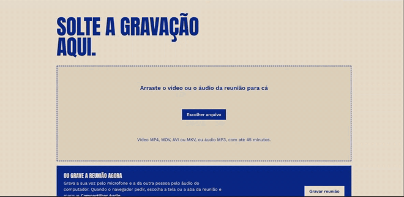

# Video Transcriber

[](https://github.com/ijmf/video-transcriber/actions/workflows/testes.yml)

Aplicação web que transcreve vídeos em português, identifica quem está falando e organiza a conversa em pautas.



- Upload de vídeos **MP4, MOV, AVI e MKV** ou áudio **MP3**, de até **45 minutos**
- **Gravar a reunião** direto na página: microfone + áudio do computador (Chrome ou Edge)
- Extração do áudio com **ffmpeg**
- Transcrição com **identificação de falantes** ([AssemblyAI](https://www.assemblyai.com/)), no formato `[00:00] João: texto`
- Renomear os falantes ("Falante A" → "João"); a IA sugere nomes quando eles aparecem na conversa
- **Organização por pautas** com a IA que você preferir (Claude, ChatGPT, Gemini, OpenRouter ou Ollama local): objetivo, contexto, participantes, problemas levantados, decisões, soluções propostas, pendências (responsável e prazo) e próximos passos, cada item com o timestamp onde foi falado
- **Pautas automáticas**: assim que a transcrição termina, a IA já organiza as pautas (dá para desligar)
- **Histórico**: as transcrições e pautas ficam guardadas no computador e sobrevivem a reiniciar o app; dá para reabrir ou apagar
- Copiar ou baixar a transcrição (`.txt`) e as pautas (`.md`)
- Sem chave da AssemblyAI, a transcrição roda no **Whisper local** (modelo `small`), sem identificação de falantes

## Requisitos

- **Python 3.13**
- **ffmpeg** (com `ffprobe`) no `PATH`
- Chave da **AssemblyAI** (transcrição com falantes) e uma IA para as pautas: chave da Anthropic, OpenAI ou Google, conta no OpenRouter, ou o Ollama instalado (gratuito, roda no computador)
- Para o modo Whisper local: ~3 GB livres (PyTorch + modelo `small`, ~460 MB, baixado no primeiro uso)

### Instalando o ffmpeg no Windows

```powershell
winget install Gyan.FFmpeg
```

Feche e abra o terminal depois e confira com `ffmpeg -version`.

Se o ffmpeg não estiver no `PATH`, o app procura sozinho a instalação do winget (`%LOCALAPPDATA%\Microsoft\WinGet\Packages\*FFmpeg*`). Para outro local, defina a variável `FFMPEG_DIR` com a pasta `bin` do ffmpeg.

## Instalação

```powershell
git clone https://github.com/ijmf/video-transcriber.git
cd video-transcriber
py -3.13 -m venv .venv
.\.venv\Scripts\Activate.ps1
python -m pip install --upgrade pip
pip install -r requirements.txt
copy .env.example .env
```

Abra o `.env` e preencha `ASSEMBLYAI_API_KEY`. O `.env` está no `.gitignore` e não vai para o repositório.

Sem a chave da AssemblyAI, instale também o Whisper local (PyTorch incluído, ~3 GB):

```powershell
pip install -r requirements-whisper.txt
```

A IA das pautas se escolhe na própria página, em **IA das pautas → Configurar** (no topo):

| Opção | O que precisa |
|---|---|
| Claude (Anthropic) | Chave de API em platform.claude.com. A assinatura Claude Pro não vale para outros apps. |
| ChatGPT (OpenAI) | Chave de API em platform.openai.com, cobrada à parte do ChatGPT Plus. |
| Gemini (Google) | Chave do Google AI Studio (tem plano gratuito, com limites). |
| OpenRouter | Clique em **Entrar com OpenRouter** e autorize: dá acesso a Claude, GPT, Gemini e outros com um login só. |
| Ollama (local) | Instale o [Ollama](https://ollama.com/download) e baixe um modelo, ex.: `ollama pull qwen2.5:7b`. Sem conta e sem custo, porém mais lento. |

Use **Testar conexão** para listar os modelos da sua conta e **Salvar**. A escolha e a chave ficam em `ia_config.json`, ao lado do app, que também está no `.gitignore`. Chaves no `.env` (`ANTHROPIC_API_KEY`, `OPENAI_API_KEY`, `GEMINI_API_KEY`, `OPENROUTER_API_KEY`) valem como padrão.

> O PyTorch instalado pelo pip no Windows é a versão CPU. Se você tiver GPU NVIDIA e for usar o Whisper local,
> instale a versão CUDA antes do `requirements-whisper.txt` (veja https://pytorch.org/get-started/locally/).

### Com Docker

Só precisa do [Docker](https://docs.docker.com/get-docker/); Python e ffmpeg já vêm na imagem.

```bash
git clone https://github.com/ijmf/video-transcriber.git
cd video-transcriber
cp .env.example .env
docker compose up -d --build
```

Abra http://127.0.0.1:5000. A porta fica publicada só em `127.0.0.1`, então o app continua acessível apenas deste computador. A escolha da IA, o histórico e o modelo do Whisper ficam no volume `dados` e sobrevivem a atualizações da imagem (`git pull` e `docker compose up -d --build`).

- Sem chave da AssemblyAI, construa a imagem com o Whisper local (CPU; a imagem passa de ~0,9 GB para ~3,6 GB): `WHISPER=1 docker compose up -d --build`.
- Ollama instalado fora do Docker: em **IA das pautas**, use o endereço `http://host.docker.internal:11434`.
- Parar: `docker compose down` (o volume com a configuração continua lá).

## Uso

```powershell
.\.venv\Scripts\Activate.ps1
python app.py
```

Abra http://127.0.0.1:5000 e envie um vídeo ou áudio, ou clique em **Gravar reunião**. Para gravar, o navegador pede o microfone e depois o compartilhamento de tela: escolha a tela ou a aba da reunião e marque **Compartilhar áudio** (é assim que a voz da outra pessoa entra). Ao clicar em **Parar e transcrever**, a gravação segue direto para a transcrição. Avise os participantes de que a reunião está sendo gravada.

Quando a transcrição terminar, tudo aparece na mesma página:

1. Em **Quem está falando**, dê nome a cada falante e clique em **Salvar nomes**.
2. Em **Pautas**, as pautas aparecem sozinhas em 30 s a 2 min, se a IA estiver configurada. Depois de renomear os falantes, clique em **Refazer pautas** para usar os nomes. Para gerar só quando quiser, desmarque **Gerar as pautas assim que a transcrição terminar** em **IA das pautas**.
3. Copie ou baixe a transcrição e as pautas.

Em **Transcrições anteriores**, no fim da página, ficam todas as transcrições já feitas: **Abrir** mostra de novo a transcrição, os falantes e as pautas; **Apagar** remove do computador. Elas ficam no arquivo `historico.db`, ao lado do app, que está no `.gitignore` (tem o conteúdo das suas reuniões).

## Custos aproximados (vídeo de 45 min)

| Etapa | Serviço | Custo |
|---|---|---|
| Transcrição + falantes | AssemblyAI | ~US$ 0,20 |
| Pautas | Claude Opus 5.5 | ~US$ 0,17 (Ollama local: grátis) |

O custo das pautas depende da IA e do modelo escolhidos em **IA das pautas**. Confira os preços atuais nas páginas de cada provedor.

## Como funciona

1. `POST /upload` recebe o vídeo, valida extensão e duração (via `ffprobe`) e cria um job.
2. Uma thread de trabalho processa um vídeo por vez: `ffmpeg` extrai o áudio → AssemblyAI transcreve com `speaker_labels` (ou o Whisper local, sem falantes).
3. A página consulta `GET /status/<job_id>` a cada segundo para mostrar o progresso.
4. `POST /speakers/<job_id>` renomeia os falantes.
5. Ao fim da transcrição, uma thread envia a transcrição à IA escolhida (`ia.py`), que devolve as pautas em JSON estruturado; `POST /pautas/<job_id>` refaz sob demanda. `GET/POST /ia` lê e salva a escolha; `POST /ia/testar` lista os modelos da conta.
6. `GET /download/<job_id>` devolve a transcrição (`.txt`); com `?tipo=pautas`, as pautas (`.md`).
7. Cada transcrição concluída, os nomes dos falantes e as pautas são gravados em SQLite (`historico.py`). `GET /historico` lista; `DELETE /historico/<job_id>` apaga.

Os arquivos de vídeo e áudio são apagados ao fim de cada job; só o texto fica no histórico. Uma transcrição em andamento quando o servidor é reiniciado se perde.

## Testes

```powershell
pip install -r requirements-dev.txt
python -m playwright install chromium
python -m pytest
```

- `tests/test_app.py` e `tests/test_ia.py`: rotas, validações do envio, proteção de Host/Origin, falantes, pautas, downloads e o adaptador das IAs (sem internet: as respostas das IAs são simuladas). Os testes de envio usam o ffmpeg de verdade.
- `tests/e2e/`: a página no Chromium com Playwright — configurar a IA, enviar um áudio, renomear falantes, gerar e baixar as pautas, e gravar a reunião com microfone falso e compartilhamento de tela simulado. A IA é um servidor falso compatível com a API da OpenAI.

Para usar o Chrome instalado em vez de baixar o Chromium: `python -m pytest --browser-channel chrome`. Para ver o navegador: `--headed --slowmo 300`.

Os testes nunca usam o seu `ia_config.json`, o seu `historico.db` nem as chaves do `.env`. No GitHub, o workflow [Testes](.github/workflows/testes.yml) roda tudo a cada push e PR, e o `pip-audit` confere as dependências (também toda segunda-feira).

## Estrutura

```
video-transcriber/
├── app.py              # servidor Flask, fila de transcrição e pautas
├── ia.py               # provedores de IA das pautas (Claude, OpenAI, Gemini, OpenRouter, Ollama)
├── historico.py        # histórico das transcrições em SQLite (historico.db)
├── requirements.txt          # dependências do app
├── requirements-whisper.txt  # Whisper local (opcional)
├── requirements-dev.txt      # testes e auditoria
├── pytest.ini
├── Dockerfile          # Python 3.13 + ffmpeg (WHISPER=1 inclui o Whisper)
├── compose.yaml        # docker compose up -d --build
├── .dockerignore
├── .env.example        # modelo do .env com as chaves
├── .gitignore
├── README.md
├── LICENSE             # licença MIT
├── templates/
│   └── index.html      # página única (HTML + CSS + JS)
├── tests/              # pytest; tests/e2e com Playwright
└── .github/workflows/
    └── testes.yml      # CI: testes, pip-audit e imagem Docker
```

## Licença

[MIT](LICENSE): pode usar, copiar, modificar e distribuir, inclusive comercialmente, mantendo o aviso de copyright.
